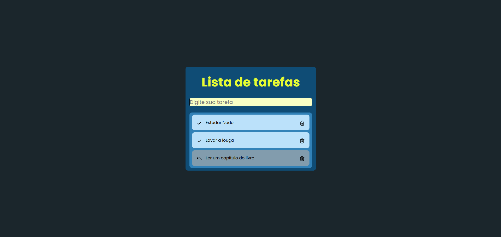
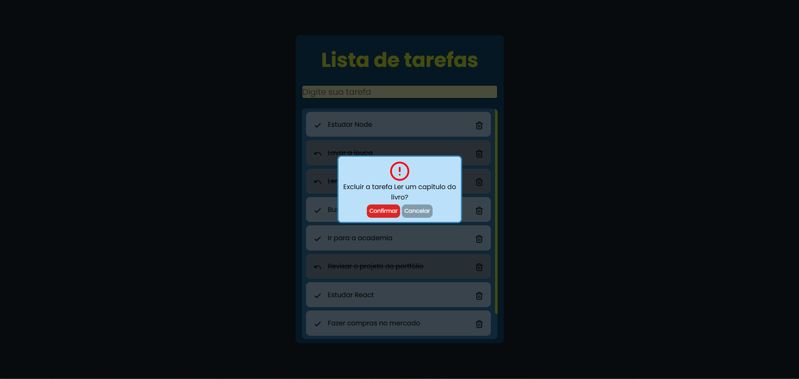
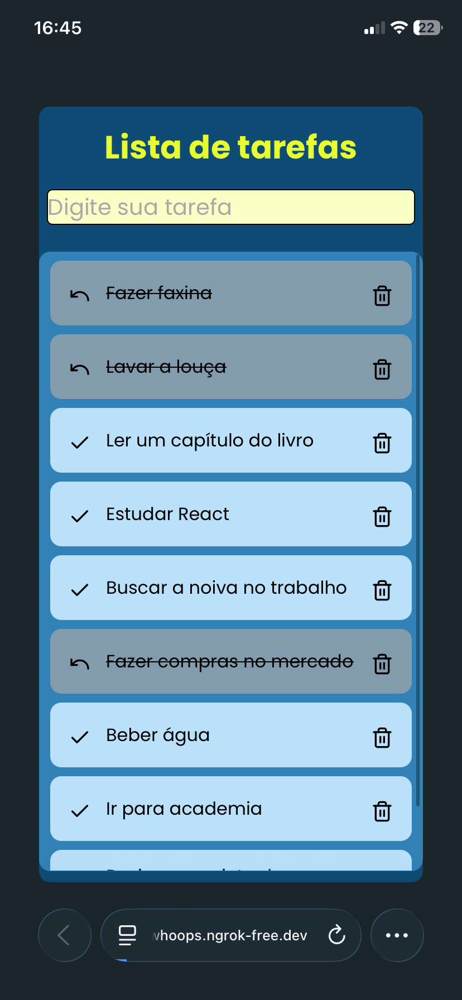

# 📝 Lista de Tarefas

Aplicação de gerenciamento de tarefas feita com **HTML, CSS e JavaScript puro**, sem frameworks. Permite criar, concluir e excluir tarefas, com os dados salvos no navegador via `localStorage`.

Este foi o meu primeiro projeto de JavaScript e faz parte do meu portfólio como desenvolvedor frontend.

🔗 **Demo:** [link do deploy na Vercel]

| Desktop | Modal de confirmação | Mobile |
|---------|----------------------|--------|
|  |  |  |

## ✨ Funcionalidades

- Adicionar tarefas pelo formulário
- Validação do campo: não aceita texto vazio, números ou símbolos, e mostra a mensagem de erro abaixo do input
- Marcar tarefa como concluída e desfazer
- Excluir tarefa com **modal de confirmação** (`<dialog>`)
- Persistência dos dados no `localStorage`: as tarefas continuam na lista ao recarregar a página
- Scroll na lista quando ela atinge a altura máxima, com a barra de rolagem estilizada
- Layout responsivo

## 🛠️ Tecnologias

- HTML5
- CSS3 (Flexbox, `clamp()`, pseudo-elementos como `::backdrop` e `::-webkit-scrollbar`)
- JavaScript (ES6+)

## 🧠 O que eu aprendi

- **Modelagem de estado:** troquei o DOM como fonte de verdade por um array de objetos `{ id, text, status }`, sincronizado com o `localStorage` a cada alteração.
- **Identificadores únicos:** uso de `crypto.randomUUID()` vinculado ao DOM com atributos `data-*`, em vez de comparar o texto da tarefa.
- **Delegação de eventos:** um único listener na `<ul>`, com `event.target.closest('button')`, para lidar com elementos criados dinamicamente.
- **Refatoração (DRY):** funções reutilizáveis, como `createTaskElement` e `toggleTaskStatus`.
- **Guard clauses:** retornos antecipados para validar o input e evitar erros com valores `null`.
- **Acessibilidade:** `role="alert"`, `aria-describedby` e `aria-hidden` nas mensagens de erro e nos ícones decorativos.
- **Elemento `<dialog>`:** `showModal()` e `close()`, além de guardar o estado entre dois cliques separados.
- **Contexto seguro:** `crypto.randomUUID()` só funciona em HTTPS ou `localhost`. Para testar no celular, usei o ngrok.

## 🚀 Como rodar o projeto

1. Clone o repositório:
   ```bash
   git clone [url-do-repositorio]
   ```
2. Abra a pasta do projeto no VS Code.
3. Inicie com a extensão **Live Server** (ou outro servidor local).

> Use um servidor local (`localhost`) em vez de abrir o arquivo direto no navegador, pois `crypto.randomUUID()` exige contexto seguro.

## 📁 Estrutura

```
├── index.html
├── css/
│   └── style.css
├── js/
│   └── script.js
└── assets/
    └── icon/
```

## 👤 Autor

**Brendon**
Desenvolvedor Frontend

- LinkedIn: [Brendon Henrique](https://www.linkedin.com/in/brendonhenrique/)
- GitHub: [Brendon Henrique](https://github.com/brendonhenrrique)
